# Bakugan: Battle Planet (2018–20)

Research notes on *Bakugan: Battle Planet*, converted from the Pages document
[`Bakugan_Battle_Planet_Data.pages`](Bakugan_Battle_Planet_Data.pages) so they can be
read on GitHub. The text below is the document's content; only the layout was
changed (headings added, the episode tables moved to [episodes.md](episodes.md)).

- [Episode guide](episodes.md): all 100 episodes with release dates, U.S. viewers and synopses
- Characters: [Dan Kuso](#dan-kuso), [Shun Kazami](#shun-kazami), [Lia Venegas](#lia-venegas), [Wynton Styles](#wynton-styles), [Lightning](#lightning), [Philomena Dusk](#philomena-dusk), [Benton Dusk](#benton-dusk), [Aay](#aay), [Magnus Black](#magnus-black), [Emily Black](#emily-black), [China Riot](#china-riot)
- Bakugan Elements: [Pyrus](#pyrus), [Aquos](#aquos), [Haos](#haos), [Ventus](#ventus), [Darkus](#darkus), [Aurelus](#aurelus)

## Characters

### Dan Kuso

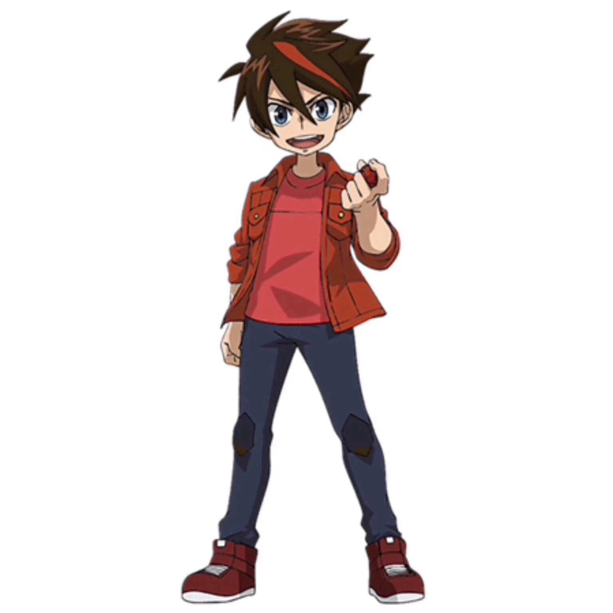

For the main character of the Battle Brawlersseries, see Dan Kuso.

For the main character of the Bakugan Gen 3series, see Dan Kouzo (Generation 3).

Dan "Daniel" Kouzo (ダン・クーソー, Dan Kūsō?)is the main protagonist in Bakugan Battle Planet. He is a Pyrus Brawler with his top Guardian Bakugan and his partner Dragonoid along with his Cyndeous. In Armored Alliance, he gained another Guardian Bakugan in Gillator. In Geogan Rising, he gains access to a powerful Geogan partner named Arcleon. He is mentioned in the Spin Master announcement of Bakugan Battle Planet.[2]

Dan has apricot skin, blue eyes and brown, spiky hair with a naturally occuring red streak. He generally wears a red t-shirt, a open darker red, elbow-length jacket, dark blue jeans with darker blue patches on the knees and red and white shoes.

Caucasian, medium height, and an athletic build. Dark hair with a red streak in it that he’s had since birth. Dan’s outfit has a modern, urban daredevil flair to it. Sporting the coolest sneakers, gloves, and pads, Dan looks like he could ride any bike, board or set of skis right up to a wall if you asked him to.

Dan is “the Talent” portion of the Awesome Brawlers. Aim a camera at this kid, give him a task and he’s sure to deliver a “like”-worthy performance. Dan is athletic, outgoing, inclusive and supportive— a natural leader, even though he doesn’t think of himself as one. Over the course of his brief and charmed life, Dan has made lots of friends but is fiercely loyal to his two besties, Wynton Styles and Lia Venegas. They have been through a lot together and even when they’ve had disagreements, no one ever goes home mad. It’s a rule with Dan: “The sun doesn’t go down until we work it out.” That’s how you make lifelong friendships. A never-say-die, charismatic force of nature, Dan could hang out with any group of kids but sticks with the crew that shares his passion for making videos and sharing them with the world. Life’s a game to Dan, but he doesn’t play to win, he plays to play. Dan accepts any challenge head-on because he wants to know what he’s capable of.

Dan is optimistic, forthcoming and intense. Like his Battle Brawlers counterpart Dan Kuso, Dan can sometimes be overconfident and has shown that goes on his knees when he loses a battle.

He's also quite eager yet impulsive as well, despite this, Dan is a caring brawler with the passion and talent to reach to the top with his friends.

Dan Kouzo is a member of the Awesome Ones a group of kids living in Los Volmos who make videos for the video site ViewTube to make end's meet. The other members include Wynton Styles, Lia Venegas, and Lightning the dog. Twelve years after the Great Collision, the Awesome Ones sneak into a restricted area of Pinpoint Park, in order to film a video for their ViewTube channel on the twelve-year anniversary of the Great Collision, in a crater caused by the Collision. While the group throws a surprise announcement for Dan's birthday, the second Great Collision occurs, causing the group to experience the Hide Matrix for the first time. Dan meets Drago, his new Bakugan partner.

Dan and the rest of the Awesome Ones and their newfound Bakugan spend their time filming videos for their ViewTube channel.

This is comprised of Dan, Wyton, Lia, and Lightning, and their Bakugan Drago, Trox, Gorthion, and Howlkor respectively, training and experimenting with BakuCores. Through this experimentation, Dan and Drago discover the abilities possible with BakuCores. The Awesome Ones share this discovery with the viewers on their ViewTube channel.

The Awesome Ones continue training with their Bakugan, to the point of exhaustion. As the other rest, Dan is persuaded by Drago to pick up food for the team at a local Burger Joint. He and Drago debate brawling possibilities when they encounter a mysterious Bakugan and its brawler robbing the Burger Joint. These turn out to be Aay and his Ventus Mantonoid. By starting a brawl with this brawler to defend the Burger Joint, Dan discovers the Drome. Using a move that Wynton and Trox used earlier, Dan and Drago defeat Aay, receiving their meals for free in compensation. The two return to the Studio D, where they collapse, exhausted from the brawl.

After another intensive day of training, Dan and Drago are confronted by Wynton and Lia about the damage they caused while training. This scolding frustrates Dan, who takes Drago goes walking around Los Volmos. They encounter three Skorporoses and their brawlers the Rowdy Reds: Mac, Max, and Maggie. Dan sees that these three young children, while playing in the park with their Bakugan, are also causing a large amount of destruction. Dan attempts to teach the Rowdy Reds how to safely use their Bakugan, and later meets up with Wynton and Lia at the Burger Joint. Dan apologies for the destruction he caused, and tells them about how he taught the Rowdy Reds about safely using their Bakugan. However, it is revealed on a television broadcast by Veronica Venegas that the lesson had no effect on the Rowdy Reds, and the team is causing destruction with there Bakugan in a new area called Costero Canyada. Dan and the rest of the Awesome Ones head to Costero Canyada, where he challenges all three of the Rowdy Reds to a brawl by himself. The brawl ends after Drago incapacitates the Rowdy Reds' Skorporos, and the Awesome Ones convince them that brawling further will only bring more destruction. After explaining to the Rowdy Reds that the Drome reverses the damage that was done inside of it after it falls, Dan and the rest of the Awesome Ones help rebuild Costero Canyada.

Dan continues to brag about his accomplishments, boasting about beating Aay and teaching the Rowdy Reds to the other members of the Awesome Ones. He claims to the new boss of the Awesome Ones, until he is interrupted by Mac and Maggie from the Rowdy Reds. They ask for the group's help in taking back their park, which Lia and Wynton goad Dan into doing by himself. Dan, the rest of the Awesome Ones, and the two members of the Rowdy Reds return to the park, finding it transformed to Marco's image, and the entrance guarded by Max. Once at the park, Dan challenges Marco to a brawl, where Marco uses underhanded tactics against him, such as preventing his Bakugan from rolling over the initial BakuCore, or attacking Dan directly. Dan runs out of the park to retrieve Drago, and finds him in a nest of young birds. While Dan and Drago are away, Marco orders Cyndeous to attack the remaining brawlers, which cause Cyndeous to fly in to a fit of rage at the cruelty of the order, and start attacking in random directions. One of the attacks is headed for Mac and Maggie, but Dan activates Drago and shields them from the blast. After Trox and Gorthion knock Cyndeous off of Drago, Drago counterattacks against Cyndeous' shield. As Cyndeous snaps out of his rage, he directly tells Marco that he will no longer be obeying his cowardly orders, which Dan and the others overhear. Seeing that Cyndeous is no longer fighting back, Dan calls the brawl over, much to Marco's dismay. Seeing Marco's yelling and rage, Dan reflects on how he had treated his friends earlier that day. Seeing the similarities to how he acted, and Marco's currently actions, Dan pushes Marco over, and ending the brawl. Later that day, after the brawl concludes, Max apologies to Mac and Maggie for his actions, which they accept. Cyndeous, seeing Dan's honorable actions during the brawl, asks Dan if he could become one of his Bakugan, which Dan accepts.

Cyndeous joins Dan in sparring against Wynton and Trox. After the sparring session, Wynton pranks Trox and Cyndeous, while filming it for ViewTube. Trox objects, but Wynton continues to film and post the prank videos. Later, Wynton shows these videos to Dan and Lia, who are amazed at the amount of views on the videos. They witness the argument between Wynton and Trox, and the subsequent wager. For the wager, Drago, Cyndeous, and Gorthion take on Trox in a three-on-one brawl, but Dan, Lia, and Wynton leave the brawl up to the Bakugan, remaining on the sidelines. The team takes down their prank videos, losing a large amount of views, but retaining the trust of Trox.

While Dan and Drago are training with Lightning and Howlkor, one of Howlkor's Prismatic Bolt attacks launches Drago in the aired, towards a nearby house. Dan recalls Drago back into his ball form to avoid destroying the house, but Drago still manages to break a window pane. The pair receive a scolding from the owner of the house, while Kravitz watches. Later that day, Dan is relaxing at his house with Drago while his parents, Bill and Barbara Kouzo prepare dinner, discussing with Drago the events of the previous afternoon. Kravitz knocks on their door, having disguised herself as a new neighbor of the Kouzo family, as well as an "Anti-Bakugan activist". When Dan's parents provided a measured response to her criticisms of Bakugan, Kravitz uses her technology from AAAnimus Inc. to force Drago out of his ball form, destroying the roof of the Kouzo's house.

The next day, the Awesome Ones find that their usual training grounds have been cordoned off, being declared a "Bakugan-free" area. They attempt to find another location to train, but every available spot is packed with other children looking for a place to use their Bakugan. At the last available spot, the group encounters Kravitz again, this time leading a group of protesters into declaring Bakugan brawling banned. The Awesome Ones return to their clubhouse, and upon seeing their viewership drop significantly, decide to make a mock-up brawling video, using cardboard cutouts of buildings and keeping their Bakugan in ball form, in order to avoid trouble. However, Kravitz has been spying on the group and uses this to her advantage, again forcing Drago, Trox, Gorthion, and Howlkor out of ball form, destroying the set. Kravitz then confronts the Awesome Ones again, disguised as the anti-Bakugan activist, along with several members of the community, include Bill and Barbara Kouzo. The group of protesters, including Dan's parents, demand that the Awesome Ones had their Bakugan over to Kravitz. Kravitz takes their Bakugan, declaring everything "safe".

While this is occurring, Benton Dusk watches, and decides to cause a weather satellite to plummet towards Los Volmos. Back in their clubhouse, the Awesome Ones watch Veronica Venegas as she reports on the incoming satellite. While Wynton and Lia scramble to grab what they can before evacuate, Dan formulates a plan: if they could get their Bakugan back, they could destroy the satellite and repair Los Volmos' perceptions towards Bakugan. The team stops Kravitz on her way out of Los Volmos, demanding their Bakugan back. Kravitz declines, but as she walks past the Awesome Ones, her device that forces Bakugan out of their ball forms is knocked from her person, falling and activating the Bakugan in the cases. The Bakugan break free, and Kravitz escapes. Drago breaks the device, and the group begins to help civilians around the city, with Dan and Drago destroying the satellite using Twisting Inferno. After seeing this, the citizens of Los Volmos, including Dan's parents, tear up their anti-Bakugan fliers, and return to accepting Bakugan.

Dan helps Lia test out her new drone technology, when she notices something in the background of her videos. Lia goes off to investigate, and when Dan and the rest of the Awesome Ones catch up to her, they find that she has discovered a new Bakugan, Pegatrix. Pegatrix exerts her influence to calm Dan and the Awesome Ones. The Awesome Ones return to their clubhouse, where they find Jenkins with a brawl offer from China Riot for Lia. Lia immediately agrees and signs the accompanying contract. After Jenkins leaves, Lia realizes that the contract has a clause in it that the requires the loser of the brawl to give their Bakugan to the winner.

Later, the team is driven to the location of the brawl: a giant stone room in the middle of a desert, and are greeted by China and Jenkins. After seeing Lia loses Gorthion to China, Dan and Wynton step up to challenge China, offering their own Bakugan up in return for Gorthion. Despite their best efforts, Drago and Trox are still surprised by the movable arena. However, with the help of Lia and Pegatrix, they are able to locate BakuCores. With the combined effort of Drago, Trox, and Pegatrix, the Awesome Ones easily beat Maxotaur, and Gorthion is returned to Lia. However, China refuses to hand over Maxotaur, and escapes with Jenkins on a helicopter.

After Aay's attack on a local shopping mall, Dan notices the aptitudes of Magnus Black (in disguise) and Shun Kazami. He invites both of them to try out for the Awesome Ones, though after seeing Magnus' reckless behavior, the group chooses to induct Shun.

Dan is approached by Bobby in order to help track down his missing Bakugan, Bear. The Awesome Ones discover that Bear has been stolen and brainwashed by Strata the Hunter. Dan and the rest of the Awesome ones manage to destroy the device controlling Bear, freeing him.

After Lightning discovers Artulean, Magnus approaches Dan in disguise, claiming to be a Bakugan counselor. Dan buys the disguise, and refers Lightning and Artulean to him in hopes that he helps then get along. After seeing that Magnus was just trying to trick them, he attempts to brawl him with Drago, only to hold back so that he doesn't hurt the brainwashed Artulean.

Veronica Venegas approaches the Awesome Ones, asking if they could do a story about their Bakugan. Dan agrees, but each of the attempts to cover something is botched by Strata in order to make Dan look good. Because of this, the other members of the Awesome Ones become annoyed with Dan. This hubris causes Dan and the other AO to become distracted during a brawl with the Exit Team. In the aftermath of the brawl, Hydorous is captured by Strata, but is later freed by Dan and Drago after the Awesome Ones reconcile.

### Shun Kazami

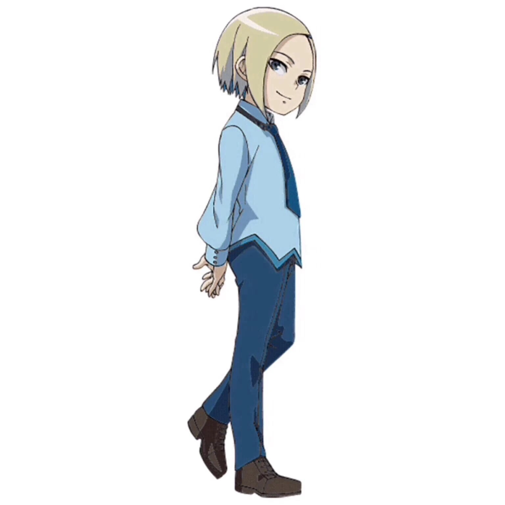

Shun Kazami' (シュン・カザミ, Shun Kazami?)is a new member recruited by the Awesome Brawlers in Bakugan Battle Planet. He is first mentioned in an announcement by Vanderwerff Talent. His Guardian Bakugan is Aquos Hydorous.[1]In Geogan Rising during Hydorous' absence, his new Guardian Bakugan was Aquos Sharktar.

Shun has pale apricot skin, blonde hair with a blue lightning-like streak and blue underhair, and teal eyes. He generally wears a light blue long-sleeved button-up shirt with a teal blue tie and darker blue trim on the bottom, dark blue jeans, and brown dress shoes.

Shun is Japanese with a medium build; his blue-blonde hair is just over his collar – a sign of rebellion for him, Shun carries himself like an adult; his serious demeanor is reflected in his choice of clothing, a clean-lined blue suit. He has one for every day of the week, just like Einstein.

Do you recall that the Awesome Ones have one fan? Well, this is him, his name is Shun Kazami and he has traveled halfway around the globe in order to join Dan Kouzo's team for Bakugan battles. Mature for his age, precocious and mysterious, Shun appears in Dan's town after witnessing Dragonoid's discovery. In fact, Shun is responsible for sharing the video with friends and letting it out into the world! Shun has been a secret student of his own Bakugan ever since their awakening, but could not find anyone who appreciated this strange new species the way he does, until now.

Shun has a deep love for Bakugan and a secret thirst for a group of friends. But Shun has led a very cloistered life. Only through watching Dan, Wynton Styles and Lia Venegas online has he found the courage to leave his home and travel to America, where he believes his true destiny awaits. But how could a ten-year-old come from Japan by himself? Could it be that his grandfather is the founder of Kazami International Holdings, makers of the tech that power almost every computer on the planet? That's exactly how.

But Shun doesn't care to brag, nor does he want to rely on his family's fortune for success, Shun has a strong drive to prove himself in his own way as a Bakugan Battler and maybe if he can relax just a little bit and let down his guard, he'll make lifelong friends in the process, Shun is about winning above all else. However, he is not ruthless or mean, just overly-focused on results. In time, his friendships with the rest of the team will make him a more well-rounded person and a better battler/player.

Much like his Battle Brawlers counterpart, he is very reserved but also very calm, he is also very thoughtful, thinking very well about things that may be something great but potentially not. An example is when he starts to think if giving the Core Cell's energy worldwide is really a good idea.

Unlike Shun's teamates, he rarely, if ever, boasts how strong he is even in battle.

Despite Shun's calmness, it breaks very easily if it has anything to do with his family in Japan due to him adamantly refusing to leave to Japan to his family and was forbidden. However, he eventually made up with his father but still wanted to join the Awesome Ones in the end.

Shun appears at the end of the first episode, watching the video between Dan and Magnus Black.

Shun discovers the Awesome Ones through their videos on ViewTube while living in Japan. He later flies to North America to attempt to join the AO, and after a series of tests against Magnus Black, he ends up succeeding and becoming a full member of the group.

Shun's first mission with the Awesome Ones is helping to track down Bear, a Bakugan of Bobby's that Strata the Hunter had brainwashed. During the final confrontation, he uses Hydorous to try and restrain Bear, but Strata overloads Bear, allowing him to easily defeat Hydorous. He is also among the training party when Lightning discovers Artulean, and ends up returning after Lightning breaks Artulean out of Magnus' brainwashing.

### Lia Venegas

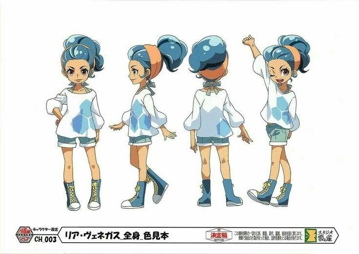

Lia has slightly tanned skin, blue poofy hair that she generally ties into a ponytail using a salmon pink headband and salmon pink eyes. She wears a pale bluish-white/whitish-blue elbow-length puffy shirt over a turquoise tank top which has tied ribbons on the back, turquoise shorts and blue and white boots with yellow shoelaces.

Chilean-American, Lia Venegas is as unique as they come. When Dan and Wynton couldn’t turn their ridiculous stunt into a successful video, it was Lia Venegas who happened by and with a few unsolicited suggestions, turned their whole scene around. Without missing a beat, Dan & Wynton asked if Lia Venegas had ever considered directing. Since then, Lia Venegas has been “the Director” of the crew and the newest best friend to Dan & Wynton. Lia Venegas is artistic, expressive, confident and inspirational to those around her. Her energy seems limitless and Lia Venegas wants you in the shot – whoever you are! Whatever you do, Lia Venegas will help you do it in the best way possible... unless you're out to bring her down. Then watch out! Lia Venegas does not deal with ‘haters.’ She’s spent her whole life standing up to people who tried picking on her for being different— but no one ever tried a second time. Lia Venegas is as strong as she is creative and never backs down from a conflict, even when she should. Like the guys, Lia Venegas is all about the fun factor and believes that those who go with their instincts live the happiest lives. Lia Venegas is an out-of-the-box thinker who helps others find their hidden talents through experimentation, fearlessness and empathy.

Lia is a caring and eccentric brawler. Lia often has a camera with her to show the world about new discoveries of Bakugan and mainly because her mother is a news reporter. Lia is very confident of her abilities similar to Dan, but unlike Dan, Lia's confidence never shifts into arrogance.

However, she can have a temper relatively easily, normally if she is called a name.

Lia is easily the most sympathetic of the Awesome Brawlers, as she tried to understand Haos Cubbo's due to him having an annoyance with them and eventually becoming friends.

Lia Venegas is a member of the Awesome Ones, a group of kids living in Los Volmos who make videos for the video site ViewTube. The other members include Dan Kouzo, Wynton Styles, and Lightning the dog. Twelve years after the Great Collision, the Awesome Ones sneak into a restricted area of Pinpoint Park, in order to film a video for their ViewTube channel on the twelve-year anniversary of the Great Collision, in a crater caused by the Collision. While the group throws a surprise announcement for Dan's birthday, the second Great Collision occurs, causing the group to experience the Hide Matrix for the first time. Lia meets Gorthion, her new Bakugan partner.

Lia and the rest of the Awesome Ones and their newfound Bakugan spend their time filming videos for their ViewTube channel. This is comprised of Dan, Wyton, Lia, and Lightning, and their Bakugan Drago, Trox, Gorthion, and Howlkor respectively, training and experimenting with BakuCores. The Awesome Ones share this discovery with the viewers on their ViewTube channel.

The Awesome Ones continue training with their Bakugan, to the point of exhaustion. While Dan and Drago are out getting meals for the group, Wynton, Lia, and Lightning attempt to sleep while their respective Bakugan demand brawls, and try to wake them up through various methods, such as with a loud horn. Lia and Wynton wake up when Dan and Drago return to the Studio D from their run to the local Burger Joint, and are ready to continue brawling.

After Dan and Drago recklessly train in nearby field, which causes a large amount of destruction, Lia and Wynton confront Dan about the amount of destruction the brawler and Bakugan pair had caused. Dan is frustrated by this confrontation, and walks off. Lia and Wynton later meet up with Dan at the Burger Joint, where Dan brags to them about having solved the problem with the Rowdy Reds. However, a news broadcast by Veronica Venegas deconfirms this; it shows the Rowdy Reds wrecking destruction on another area of Los Volmos, Costero Canyada. Lia and the Awesome Ones head to Costero Canyada to stop the destruction, and Lia lets Dan take care of the problem himself.

While resting at the Studio D, Lia and Wynton push back against Dan's bragging, until they are interrupted by Mac and Maggie of the Rowdy Reds, who ask for help in defeating Marco Chezanello. Lia and Wynton goad Dan into attempting to handle the situation by himself. Lia, the rest of the Awesome Ones, and the two members of the Rowdy Reds return to the park, finding it transformed to Marco's image, and the entrance guarded by Max. After Drago in ball form is blown away by Marco's Pyrus Cyndeous, Lia and Wynton use Gorthion and Trox to brawl Marco. As Gorthion and Trox are charging Cyndeous, they fall into a hidden pit, trapping them. Gorthion and Trox are hit by Cyndeous Sword Barrage while defenseless, even though Cyndeous originally protested against the act. While Dan and Drago are away, Marco orders Cyndeous to attack the remaining brawlers, which cause Cyndeous to fly in to a fit of rage at the cruelty of the order, and start attacking in random directions. One of the attacks is headed for Mac and Maggie, but Dan activates Drago and shields them from the blast. Despite being their opponent, Drago also protects Marco and Max from Cyndeous' random attacks. Just as Drago is about to be incapacitated by the attacks, Gorthion knocks Cyndeous off of him. Drago then counterattacks, hitting Cyndeous' shield with a barrage of attacks. As Cyndeous snaps out of his rage, he directly tells Marco that he will no longer be obeying his cowardly orders, which Lia and the others overhear. Later that day, after the brawl concludes, Lia and Wynton accept Dan's apology for his previous arrogant attitude.

Cyndeous joins Dan in sparring against Wynton and Trox. After the sparring session, Wynton pranks Trox and Cyndeous, while filming it for ViewTube. Trox objects, but Wynton continues to film and post the prank videos. Later, Wynton shows these videos to Dan and Lia, who are amazed at the amount of views on the videos. They witness the argument between Wynton and Trox, and the subsequent wager. For the wager, Gorthion, Drago, and Cyndeous take on Trox in a three-on-one brawl, but Lia, Dan, and Wynton leave the brawl up to the Bakugan, remaining on the sidelines. The team takes down their prank videos, losing a large amount of views, but retaining the trust of Trox.

After Kravitz makes her initial entrance into Los Volmos, she seeks to alter people's perceptions of Bakugan to something that they distrust. Lia, Wynton and their respective Bakugan are training in a park when Trox is knock out of the park's bounds. Trox recalls into ball form to avoid damage, and rolls underneath a car. Kravitz takes this opportunity to force Trox out of ball form using her technology from AAAnimus Inc, damaging the surrounding property. Later, Lia and Gorthion are ordering a pastry at a local food stall when Kravitz again uses her technology to force Gorthion out of ball form, destroying the stall and harm people's perceptions of Bakugan.

The next day, the Awesome Ones find that their usual training grounds have been cordoned off, being declared a "Bakugan-free" area. They attempt to find another location to train, but every available spot is packed with other children looking for a place to use their Bakugan. At the last available spot, the group encounters Kravitz again, this time leading a group of protesters into declaring Bakugan brawling banned. The Awesome Ones return to their clubhouse, and upon seeing their viewership drop significantly, decide to make a mock-up brawling video, using cardboard cutouts of buildings and keeping their Bakugan in ball form, in order to avoid trouble. However, Kravitz has been spying on the group and uses this to her advantage, again forcing Drago, Trox, Gorthion, and Howlkor out of ball form, destroying the set. Kravitz then confronts the Awesome Ones again, disguised as the anti-Bakugan activist, along with several members of the community, include Bill and Barbara Kouzo. The group of protesters, including Dan's parents, demand that the Awesome Ones had their Bakugan over to Kravitz. Kravitz takes their Bakugan, declaring everything "safe".

While this is occurring, Benton Dusk watches, and decides to cause a weather satellite to plummet towards Los Volmos. Back in their clubhouse, the Awesome Ones watch Veronica Venegas as she reports on the incoming satellite. While Wynton and Lia scramble to grab what they can before evacuate, Dan formulates a plan: if they could get their Bakugan back, they could destroy the satellite and repair Los Volmos' perceptions towards Bakugan. The team stops Kravitz on her way out of Los Volmos, demanding their Bakugan back. Kravitz declines, but as she walks past the Awesome Ones, her device that forces Bakugan out of their ball forms is knocked from her person, falling and activating the Bakugan in the cases. The Bakugan break free, and Kravitz escapes. Lia and Gorthion are reunited, and begin to help escort civilians out of the city. After seeing this, the citizens of Los Volmos, including Dan's parents, tear up their anti-Bakugan fliers, and return to accepting Bakugan.

Lia begins testing out some new technology to film Awesome Ones videos, when she notices something calling to her in the background of some of her test footage. She runs off into the woods, coming across a shining white flower in the middle of a clearing. This flower becomes enveloped in the same goop that appeared during the second Great Collision and bursts, causing Lia to recoil. When she opens her eyes, she realizes that she's holding a new Bakugan, Pegatrix. After the Awesome Ones return to their clubhouse, and find Jenkins with a brawl offer from China Riot for Lia. Lia immediately agrees and signs the accompanying contract. After Jenkins leaves, Lia realizes that the contract has a clause in it that the requires the loser of the brawl to give their Bakugan to the winner. Pegatrix warns Lia against going into the brawl stubbornly and without thinking it through, but Lia brushes her off, claiming that she "won't lose".

Later, the team is driven to the location of the brawl: a giant stone room in the middle of a desert, and are greeted by China and Jenkins. Lia rushes hastily into battle, being baited by China's slow pace towards starting the brawl. Lia sends out Gorthion against China's Ventus Maxotaur, but is further distracted by China. Needing a BakuCore, Lia attempts to grab a Haos one close to her on the Hide Matrix, however China has a series of hidden platforms that can rise and fall on her command, which prevent Lia from obtaining access to any BakuCores. Due to her inability to grab BakuCores, and general distracted state, Lia loses the brawl, and Gorthion. Dan and Wynton step up and challenge China in order to win Gorthion back. Lia, upset over the loss of her partner, is consoled by Pegatrix, and the two of them work to help Drago and Trox. Pegatrix acts as an "eye in the sky", locating BakuCores for Dan and Wynton. With the combined effort of Drago, Trox, and Pegatrix, the Awesome Ones easily beat Maxotaur, and Gorthion is returned to Lia. However, China refuses to hand over Maxotaur, and escapes with Jenkins on a helicopter.

Lia helps out with the contest between Magnus Black and Shun Kazami to join the Awesome Ones. She helps to track down Bear, a Bakugan of Bobby's that Strata the Hunter had brainwashed. During the final confrontation, she uses Pegatrix to try and restrain Bear. She is also among the training party when Lightning discovers Artulean, and ends up returning after Lightning breaks Artulean out of Magnus' brainwashing.

In Honey Struck, a small Haos Bakugan named Cubbo joined Lia.

### Wynton Styles

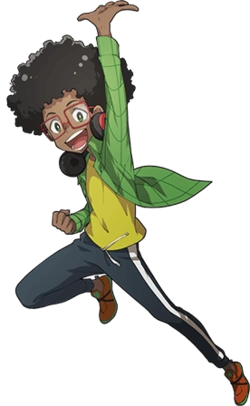

Wynton Styles (ウィントン・スタイルズ, U~inton Sutairuzu?) is one of the main characters in the Bakugan: Battle Planet series. His Guardian Bakugan is Ventus Trox. In Geogan Rising, after Trox's absence, his new Guardian Bakugan is Ventus Falcron.

Wynton has brown skin, black hair that is styled into an afro and green eyes. He generally wears a yellow t-shirt, a open green long-sleeved jacket, black and red-circle headphones that he wears around his neck, dark blue jeans with white lines on the side, pink socks and orange shoes with black stripes, green soles and green parts on the tongues. He also wears red square glasses

Stout body type, cool glasses, and black afro. Wynton has a laid-back slacker-hacker style that accommodates the endless bits of gear and tech he seems to produce from thin air. A multi-purpose “hack-pack” slung over his shoulder completes the look. Wynton and Dan Kouzo have been friends since the first grade. They met when Dan tried to backflip off of the lunch table and his hand-held game system went flying into a wall. Wynton fixed it with a paperclip and some gum. Yes, Wynton is smart. Really smart. And like a lot of smart kids he keeps his talents to himself because he doesn’t like the expectations that the world puts on him. The only kids who know the real Wynton are Dan and Lia Venegas because they see him as a complete person. So even though Wynton is definitely the brains of the crew, don’t call him smart without adding the word “mouth” after it. Overcompensating for his excessive intelligence, Wynton is a prankster whose jokes often get him in hot water. He has been cooking up chaos with Dan since forever. It makes for great videos... and the occasional trip to the Principal’s office. Wynton is an analytical thinker who uses his perspective to uncover the hidden secrets of people, places, and things, though he rarely looks inside of himself.

For his age, Wynton is highly intelligent. Wynton's intelligence is high enough for him to make his own devices. For example, he was smart enough to devise a Core Cell Tracker which would lead them to a place with the most concentration of the Core Cell.

However, he could often add disdain into his intelligence, due to which it could sometimes be said that his attiude is patronizing.

He also loves to do pranks to people and mainly Dan Kouzo.

Despite these traits, Wynton is very smart, friendly and an important member of his team.

### Lightning

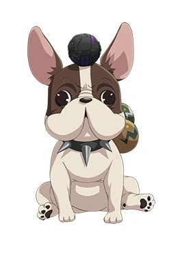

Lightning (ライトニング, Raitoningu?) is a French bulldog character in Bakugan Battle Planet. He uses Darkus Bakugan and his Guardian Bakugan is Howlkor. In Geogan Rising after Howlkor's absence, his new Guardian Bakugan was Darkus Ferascal.

A French Bulldog, Lightning sports a collar that allows him to carry and release his own Bakugan. All kids filming prank videos need a lookout and for the Awesome Brawlers that lookout is Lightning. A stray found lingering in the back alley of Dan’s home, Lightning has become their unofficial mascot. A happy, dumpy, sleepy French Bulldog who often co-stars with Dan, Lightning isn’t quite as fast as his name might suggest, but he’s good for a “YAP” when trouble is coming. Lightning is the best dog in the world... and that was before the kids discovered that he could fight alongside them with Bakugan! That’s right, a dog— one very special dog— has his own Bakugan and uses them in battle with his human friends! During downtime, Lightning is usually sleeping, eating, or playing with the Bakugan roaming around Dan’s house. But when trouble rears its head, Lightning snaps into warrior mode and can brawl with the best of them! Lightning is a dog, it’s a little wacky that a dog is an active part of Dan’s team, but as an animal, he has a different relationship with Bakugan than any human could ever hope to have. His animal instincts can mean the difference between success and defeat for the whole team. And no, Lightning does NOT talk— at least not in any way humans can understand. But his loyalty to his friends--human and Bakugan alike--give his partners faith in his abilities... Even if he does occasionally bury a Bakugan in the backyard.

Lightning has white fur with brown parts. He has brown ears, brown patches on the sides of his head, brown eyes, a brown heart-like symbol on the side of his body and a small brown tail.

Lightning tags along with the Awesome Ones as they sneak into Pinpoint Park to film a video at a crater caused by the original Great Collision. Along with the rest of the members, he is caught up in the second Great Collision and discovers Darkus Howlkor, his Guardian Bakugan.

Lightning and the rest of the Awesome Ones and their newfound Bakugan spend their time filming videos for their ViewTube channel. This is comprised of Dan, Wyton, Lia, and Lightning, and their Bakugan Drago, Trox, Gorthion, and Howlkor respectively, training and experimenting with BakuCores. The Awesome Ones share this discovery with the viewers on their ViewTube channel.

Lightning accompanies the rest of the Awesome Ones during a long night of training of brawling. While Dan and Drago are out getting meals for the group in the morning, Wynton, Lia, and Lightning attempt to sleep while their respective Bakugan demand brawls, and try to wake them up through various methods, such as with a loud horn.

Lightning accompanies Wynton and Lia when they confront Dan and Drago about the destruction they caused while training. He also meets up with the Awesome Ones at the Burger Joint, after Dan's initial encounter with the Rowdy Reds.

While Lightning and Howlkor are training with Dan and Drago, one of Howlkor's Prismatic Bolt attacks launches Drago in the aired, towards a nearby house. Dan recalls Drago back into his ball form to avoid destroying the house, but Drago still manages to break a window pane. The pair receive a scolding from the owner of the house, while Kravitz watches. The next day, the Awesome Ones find that their usual training grounds have been cordoned off, being declared a "Bakugan-free" area. They attempt to find another location to train, but every available spot is packed with other children looking for a place to use their Bakugan. At the last available spot, the group encounters Kravitz again, this time leading a group of protesters into declaring Bakugan brawling banned. The Awesome Ones return to their clubhouse, and upon seeing their viewership drop significantly, decide to make a mock-up brawling video, using cardboard cutouts of buildings and keeping their Bakugan in ball form, in order to avoid trouble. However, Kravitz has been spying on the group and uses this to her advantage, again forcing Drago, Trox, Gorthion, and Howlkor out of ball form, destroying the set. Kravitz then confronts the Awesome Ones again, disguised as the anti-Bakugan activist, along with several members of the community, include Bill and Barbara Kouzo. The group of protesters, including Dan's parents, demand that the Awesome Ones had their Bakugan over to Kravitz. Kravitz takes their Bakugan, declaring everything "safe".

While this is occurring, Benton Dusk watches, and decides to cause a weather satellite to plummet towards Los Volmos. Back in their clubhouse, the Awesome Ones watch Veronica Venegas as she reports on the incoming satellite. Dan formulates a plan: if they could get their Bakugan back, they could destroy the satellite and repair Los Volmos' perceptions towards Bakugan. The team stops Kravitz on her way out of Los Volmos, demanding their Bakugan back. Kravitz declines, but as she walks past the Awesome Ones, her device that forces Bakugan out of their ball forms is knocked from her person, falling and activating the Bakugan in the cases. The Bakugan break free, and Kravitz escapes. Lightning and Howlkor are reunited, and begin to help escort civilians out of the city. After seeing this, the citizens of Los Volmos, including Dan's parents, tear up their anti-Bakugan fliers, and return to accepting Bakugan.

Lightning helped Lia test out her new drone technology, when she notices something in the background of her videos. Lia goes off to investigate, and when Lightning and the rest of the Awesome Ones catch up to her, they find that she has discovered a new Bakugan, Pegatrix. Pegatrix exerts her influence to calm Dan and the Awesome Ones. The Awesome Ones return to their clubhouse, where they find Jenkins with a brawl offer from China Riot for Lia. Lia immediately agrees and signs the accompanying contract.

Lighting helped out with the contest between Magnus Black and Shun Kazami to join the Awesome Ones. He later is part of the party that tracks down Bear, a Bakugan of Bobby's that Strata the Hunter had brainwashed. In the confrontation, Lightning ends up destroying the device controlling Bear, setting him free.

In Dog Daze, after discovering a ball of goo, Lightning found a new Bakugan partner, Artulean. Lightning attempts to introduce Artulean to Howlkor, though the two do not get along well. However, due to the meddling of Magnus Black, Artulean is turned against the Awesome Ones, but is brought back to her sense by Lightning.

Lightning is the canine member of the Awesome Brawlers. Despite being non-human, he is shown to be a capable brawler, giving instructions to his Bakugan through his barks. He has two small balls attached to his collar that allows him to easily carry and summon his Bakugan.

### Philomena Dusk

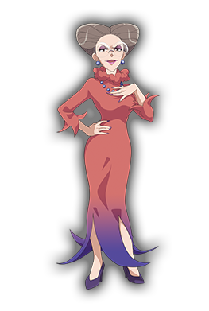

Philomena Dusk was a major antagonist later supporting character that appeared in Bakugan: Battle Planet. She is the older sister of Benton Dusk.

Philomena is an adult woman who has an hourglass body shape. She has gray hair in an unknown hairstyle and pale skin. Philomena wears blue ball shaped earrings on her ears. She has brown eyes with magneta make-up on her top eyelids.

Philomena is Benton Dusk's older, meaner, and smarter sister. After Benton had serious falling out with his father, Philomena took up the mantle of Chief Officer of the Dusk business empire & took it to every corner of the planet. Ruthless and pragmatic, Philomena has no love for her wayward brother Benton. If anything, she would relish taking him completely out of the picture. With an intimate knowledge of the Bakugan phenomenon, Philomena has spent a fortune attempting to unlock their secrets and bring their vast potential to bear for AAAnimus Inc.

Intially, Philomena was a cold, cunning, callous, manipulative, overbearing and aloof lady. She normally just look down on the Awesome Ones and even Magnus, even though he's was part of AAAnimus Inc.

Philomena possesses a similar intelligence as Benton, maybe even a bit more.

She also has great hostility against her younger brother, Benton and thinking that everything Benton had belonged to her.

However after the event when Magnus was freed from Tiko, she began to become less aloof and arrogant and has become nicer and more friendly. Even willing to help save her brother from Tiko's influence.

AAAnimus Inc. is a global, multinational organization formerly operated by Benton Dusk, & currently operated by Philomena Dusk. It has been in the Dusk family at least as far back as Philomena & Benton's father.

Philomena Dusk is the Chief Officer of AAAnimus Inc. She is a Haos Brawler and her Guardian Bakugan is Apollyon.

Benton Dusk is the former Chief Officer of AAAnimus Inc. & the younger brother of Philomena. He is an Aquos Brawler and his Guardian Bakugan is Hydranoid.

Kravitz Kravitz was Philomena's second in-command and is a complete narcissist who is very self-righteous, She now works for AAAnimus Inc. as a assistant of Philomena Dusk.

#### Secondary Members

Magnus Black is a masked boy who is the archrival of Dan Kouzo. Despite working for AAAnimus, Magnus is a strong believer in the Bushido code of the samurai— though he has clearly lost his way. He is a Darkus Brawler, & his Guardian Bakugan is Nillious.

Col. Armstrong Tripp is AAAnimus's main adult Bakugan Battler. He was originally a Haos Brawler and his Guardian Bakugan was Pandoxx. However, he switched attributes later on and became a Darkus Brawler. His new Guardian Bakugan is Cloptor.

Strata the Hunter is a hunter who makes a living hunting down Bakugan. He is an Aquos Brawler, & his Guardian Bakugan is Krakelios.

China Riot is a 6-year-old Bakugan Battler phenomenon who works for AAAnimus & will go wherever she is needed to help advance the company’s goals, her primary personal goal is the be the best & cutest Bakugan fighter ever. She is a Ventus Brawler, & her Guardian Bakugan is Maxotaur.

Kurin is a boy, who was sent to spy on the Awesome Ones. He is a Darkus Brawler and his Guardian Bakugan is Garganoid.

#### Exit Team

_Main article: Exit Team_

A corporate-sponsored group of hired kid Bakugan battlers that worked efor AAAnimus, the Exit Team are both well-equipped & more ruthless than the Awesome Ones.

### Benton Dusk

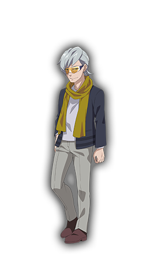

Benton Dusk is the major supporting character that appears in Bakugan Battle Planet. He is the younger brother of Philomena Dusk.

A mysterious, enigmatic figure, Benton Dusk plays a pivotal role in the world of Bakugan. As a world-famous business magnate, investor, engineer, & inventor, Dusk is truly a modern renaissance man. He is ranked as the 79th wealthiest person in the world & ranked 16th on Culture Magazine's list of the World's Most Influential People. The very existence of the Bakugan holds great interest for Dusk. For him, they fall right in line with how he sees the future of humanity. His goal is to keep Bakugan & their powers open source. In other words, available for all to use. To that end, Benton recruits Dan Kouzo & the Awesome Ones to aid his personal quest to collect the Core Cells. While he starts out as a mysterious benefactor, he reveals himself as one of the good guys, mentoring the young heroes.

Benton keeps a lot of secrets about himself from the Awesome Ones, until he reveals his actions to them in assisting in their cause to defend the Bakugan and bring unity between both races.

### Aay

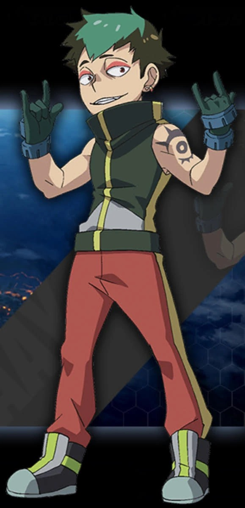

AAY is the leader of the Exit Team in Bakugan: Battle Planet. Not much is known about him at this time, except the fact he's a Ventus Brawler.

Aay is a condescending and arrogant Bakugan battler with the rude personality to match. Even when facing non combatants, Aay expects the world to obey him without any questions.

### Magnus Black

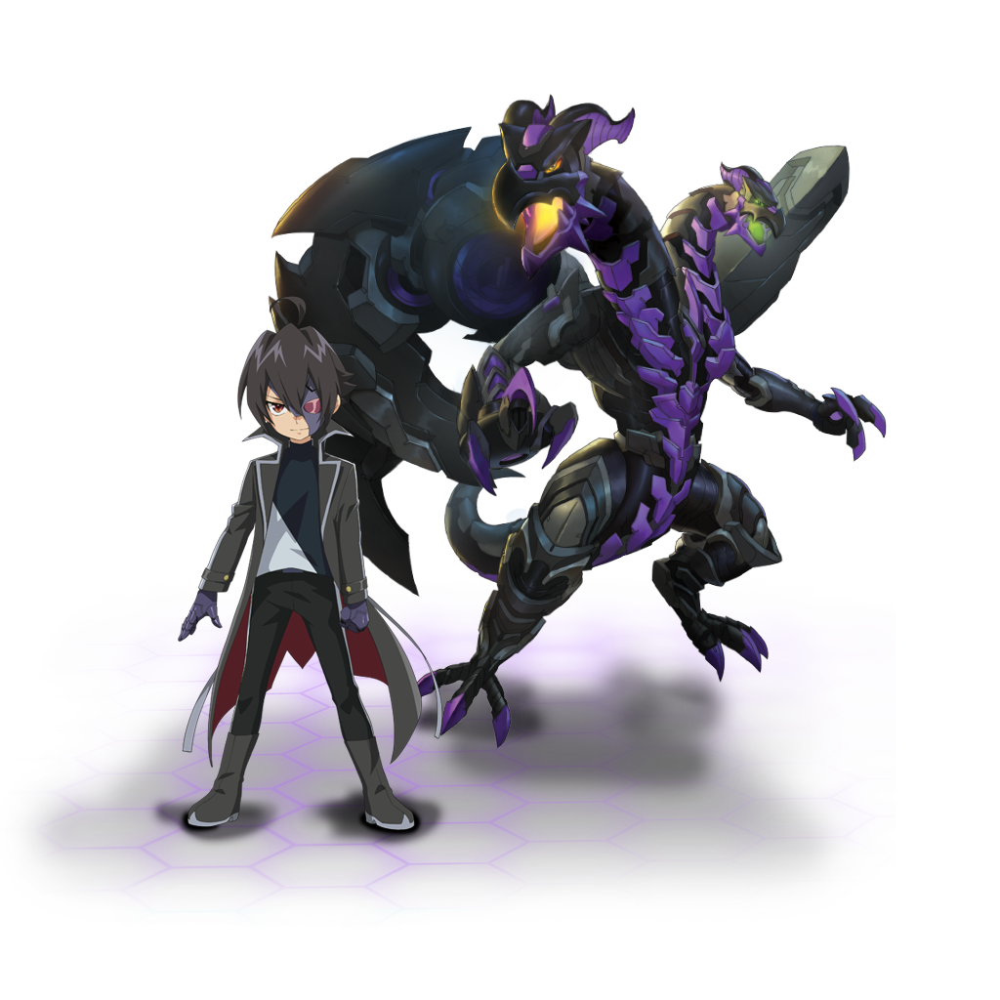

Magnus Black (マグナス・ブラック, Magunasu Burakku?) is a recurring character that appears in Bakugan: Battle Planet. He is a Darkus Brawler and his Guardian Bakugan is Nillious.

Magnus is quite tall, with shaggy black hair with an ahoge and persian red eyes. His attire includes a black tailcoat with grey accents, high collar and yellow buttons on the tailcoat's wrist, a black and white vest underneath. He wears a royal purple half-mask with persian red lens that only shows his right eye and mouth and wears royal purple gloves.

When working for AAAnimus and beign a vigilante Magnus wore a large purple gauntlet and small bracelet on his left arm.

A masked boy wielding the powerful Nillious who becomes Dan’s number one rival. Magnus has no interest in fame and keeps his identity a mystery. Despite working for AAAnimus, Magnus is a strong believer in the Bushido code of the samurai— though he has clearly lost his way. Ultimately, we will learn that Magnus has chosen this path for a noble purpose— AAAnimus is promising life-saving technology and medicines for his sister, who is incapacitated by a rare disease. Though he fights to save his sister, part of Magnus is ashamed of his actions, so he hides behind a mask and his strict code of honor in the field. Armed with a cadre of powerful Bakugan, Magnus is the best Battler out there… Except for Dan Kouzo. Magnus takes an instant dislike to Dan because it’s obvious that this boy is special and his bond with his Bakugan is noble. Magnus turns his jealousy into a drive, dedicating himself to becoming the best battler possible in order to take down Dan Kouzo, and save his sister once and for all.

Magnus has a dark personality along with being highly enigmatic. He is normally quiet though he can get angry quite easily if annoyed by constant talking, shown in episode 60 with Dan. Magnus doesn't really like being around anyone either, due to his shame in the past.

Despite being cool and distant, Magnus has a soft spot for his sister. Due to her for having a rare disease, Magnus worked for AAAnimus Inc. in order for them to give her good health, and because of this, he is a dedicated brawler who takes Bakugan very seriously- he doesn't brawl for fun, he brawls to win at any cost for his sister.

After he left AAAnimus Inc because of the defeat with Dan, he seems more power-hungry, as he constantly claims that the power of the Core Cell will be his- mainly due to feeling more helpless, as well as not being able to help his sister.

He's also shown to be highly intelligent as he hacked AAAnimus Inc.'s system in order to find the location of the Core Cell.

It is unknown how he officially treats his Bakugan since they are shown to have no conversations together, but throughout Battle Planet it can be implied that he doesn't care about having a relationship with his Bakugan (other than establishing a relationship where they'll obey his commands in battle). Things change in Armored Alliance episode 46 when he begins to realise just how much of a problem it is for him not to be able to understand Bakugan. At the very end of that episode, he asks if Nillious and Enoch helped him because his device forced them to, clearly upset about the fact they can't really answer him, suprisingly however Nillious does respond, telling Magnus that they helped "Because we are partners." After Magnus gets over his confusion as to who the voice was, he looks down at the Bakuballs in his hand and smiles. Then in Geogan Rising, after Magnus grows younger due to the maze and becomes able to understand Bakugan, his expression when he discovers this, again after the initial shock, is clear joy. Proving that Magnus's attitude towards Bakugan has changed throughout the seasons and he truly does care about having a relationship with his Bakugan.

However, during the time when he was possessed by Tiko, Magnus became crazed and psychotic. Overall, he was hostile and arrogant. But he lost all of those demeanors, and reverted back to his normal self, due to his defeat with Dan. He has now shown approval to him by accepting Dan's offer to battle again (in the future) as a game. During the final fight against Tiko, before Dan returned, Magnus fights for Dan to keep a promise. This suggests that Magnus does, at the very least, respect Dan since he is willing to fight to keep a promise.

Magnus is first seen battling The Awesome Ones and ultimately loses against them.  Origin of the Species Part 1 Origin of the Species Part 2

Some time later he disguises himself as a brawler, also named Magnus, in order to join the Awesome Ones. However another brawler named Shun Kazami also wants to join. Although he shows that he is a very strong brawler, he fails to convince the Awesome Ones, because he is lacking characteristics which are needed in a team. The Awesome Ones are not aware that he is the Magnus they battled some time ago.  Frenemies

Later on, he disguises himself again as a Bakugan advisor and offers the Awesome Ones his help, with them entrusting Artulean to him. Very soon he blows his cover and uses Artulean for another battle against the Awesome Ones, reminding the former of the fact that they apparently considered him a problematic Bakugan. However, after Howlkor reminds him of their friendly relationship, Magnus' control over Artulean begins to wane. Soon after the other brawlers also reappear, which causes Magnus to leave.  Dog Daze

### Emily Black

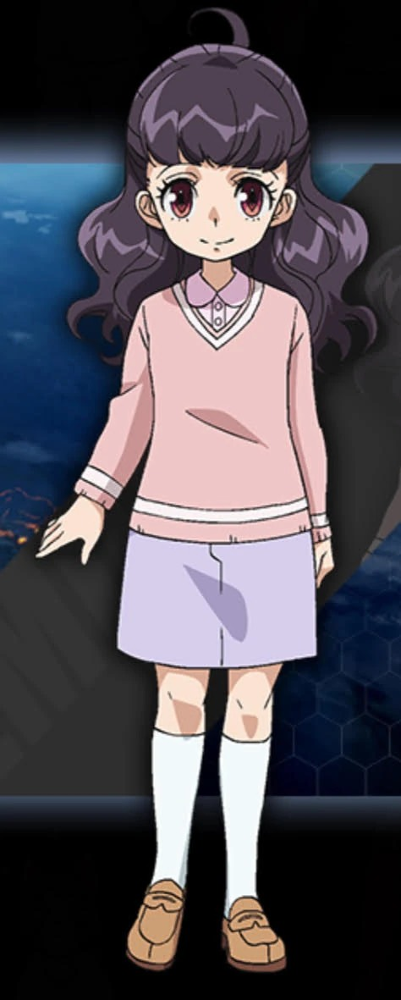

Emily is Magnus's younger sister and is a character shown in Battle Planet, Armored Alliance, and Geogan Rising.

Emily seems to look quite alike from her brother, Magnus. She has a similar hair color (although her's seems to have some lighter shades of purple in the light, compared to Magnus), an ahoge, and the same persian red eye color. She is usually bed ridden, but she is usually seen wearing a light pink long sleeve, a (different shaded) pink collar shirt under the long sleeve, an over the knee light purple skirt, knee high white socks, and oxford flat shoes

Emily has suffered from a serious ailment from a very young age, which is why she is usually bed ridden. Because of this, Magnus always tries to give the best to her, but this usually comes with a cost for him. This cost to Magnus always concerns Emily, because as much as Magnus wants the best for her, she wants the best for him.

She seems to be very kind and caring, as she is with her brother, and when she talked with the Awesome Ones.

Emily is Magnus's younger sister and is a character shown in Battle Planet, Armored Alliance, and Geogan Rising. In the first season Emily is in the hospital while her brother is with AAAnimus. She gets worried about Magnus as during the series he keeps on obsessing on getting more power. When Magnus plans on facing Dan in an epic match and plans to use his powered up device, Emily learns about this and tries to tell Dan not to battle Magnus. Dan doesn't listen and ends up losing to Hyper Nillious which is the evolves for of Nillious but all that power was to much for Magnus as it starts to injure him as Emily gets upset that Magnus is hurt and carries him away. Though when he evolves Nillious again he did not experience any pain as he trained to make sure that he did not get hurt. After Magnus gets possessed by Tiko, Emily tells the Awesome One to make sure that Magnus does not do anything dumb that gets him hurt (as she did not know about Magnus being possessed) with Dan giving Magnus that message with Magnus ignoring Dan as he thinks he is Tiko's servant. After Dan defeats Tiko Emily gets better and in the last episode of Battle Planet, it is shown that Magnus and Emily are in a garden field and they are both happy.

Magnus was the first brawler to evolve a Bakugan in Battle Planet.

Due to being born before the Great Collision, he is unable to brawl without his gauntlet or hear Bakugan talk.

In True Power, Magnus became younger enough to brawl without the use of his cuff and hear Bakugan talk. Therefore, he can hear Nillious' voice for the first time.

Magnus is the first brawler to defeat an Aurelus Bakugan.

Magnus was the only member of the Exit Team to have a win rate of over 50%.

Magnus seems to be a man of his word, which can be seen when he is willing to fight in order to keep a promise he made with Dan

### China Riot

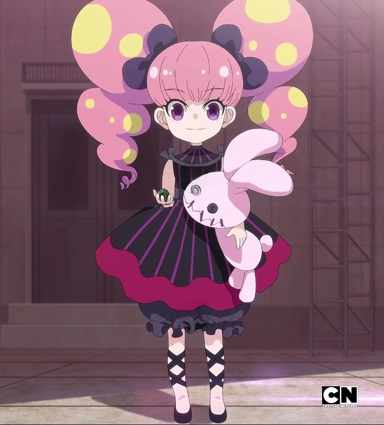

China Riot is a character that appears in Bakugan Battle Planet. She is a Ventus Brawler, and her Guardian Bakugan was Maxotaur and later on Barbetra and Sectanoid.

China is short which makes sense for her age, she has violet eyes showing eyelashes. She also has bubblegum pink hair with bangs and two large ponytails with yellow spots covered over tied with big royal purple bows. China wears a black sleeveless dress with fandango coloured stripes and rose accents. China also wears black puffed shorts, black shoes and a black ribbon tied on each wrist. China has razor sharp teeth.

This 7-year-old Bakugan Battler phenomenon is both spoiled & fearsome. Auctioning her abilities to the highest bidder, China has found a comfortable second home with AAAnimus Inc. China is driven solely by the accumulation of money and pretty things. China works for AAANIMUS and will go wherever she is needed to help advance the company’s goals, her primary personal goal is the be the best & cutest Bakugan fighter ever. Quirky, precocious, and fearsome.

China is quite vicious and witty in battle. However outside of battle, she is very cheeky, arrogant and spoiled. She also thinks she is entitled to everything such Col. Armstrong Tripp's Bakugan, and is very bossy and somewhat lazy as shown by the fact that she has waitresses that do what she says and tried to get the most credit when Dan defeated Magnus which increased her smugness.

Despite this smug and very spoiled demeanor, she seems to be on good terms with the Awesome Ones now.

She, along with Strata, both appeared before Magnus and the Awesome Ones near the end of Origin of the Species Part 2, after Magnus was defeated by them in battle.

## Bakugan Elements

### Pyrus

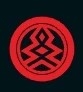

Pyrus (Japanese Version: Nova (ノヴァ, Novu~a?)) is the Attribute (or Faction) of Fire.

The Legendary Soldier of Pyrus was Apollonir. The current soldier is Drago.

Pyrus can be found at the inner core of the universe and is inhabited by Bakugan who draw their strength from the blazing heat that surrounds them. It is within these deep recesses of molten rock that their intensity is forged. Never one to waste even a second, the Pyrus blitz their enemies from every angle like a raging firestorm.

For Pyrus Bakugan, the main point of them is to simply overpower through sheer force and shutting down ways your opponent can fight back.

### Aquos

Aquos (Japanese Version: Aqua (アクア,Akua?)) is the Attribute (or Faction) of Water.

Aquos Bakugan usually have average G-Power but use trickery to either boost them or dwindle their opponent to win.

### Haos

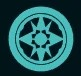

Haos (Japanese Version: Lumina (ルミナ,Rumina?)) is the Attribute (or Faction) of Light.

Haos Bakugan have the lowest G-Powers in the game, but strategy and manipulation is the main idea. Haos Bakugan are often in the battle for aid, or switch.

### Ventus

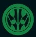

Ventus (Japanese Version: Zephyros (ゼフィロス, Zefirosu?)) is the Attribute of Earth (or Faction of Nature).

Ventus-attributed Bakugan have average G-Power. Ventus attributed Bakugan draw their power from the cunning tactics. They think before they play. They choose their Ability Cards wisely, as the biggest boost is not always the best. They lure their opponent in by giving them the upper hand and just when their opponent is getting cocky, Ventus brawlers spring their trap and come out victorious! With Ventus attributed abilities such as Blow Away, Ventus Bakugan can turn the tides in any battle.

### Darkus

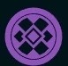

Darkus (Japanese Version: Darkon (ダークオン,Dākuon?)) is the Attribute (or Faction) of Darkness.

Darkus Bakugan have a large variety of G-Powersand Ability Cards so there are many ways to use them.

### Aurelus

Aurelus (オーレルス, Ōrerusu?) is the Attribute (or Faction) of Creation.

This was introduced in Bakugan Battle Planet, replacing Subterra. So far, the four Aurelus (or golden) Bakugan were introduced in Battle Planet; Pyravian, Tiko, Trhyno, and Goreene. As well, the five Aurelus Bakugan were introduced in Bakugan: Armored Alliance are Pharol, Auxillataur, Zellus, Etris, and Garillion. Six new Aurelus Bakugan were introduced in Bakugan: Geogan Rising; Pincitaur, Spartillion, Titan King, Viloch, Auratoa, and Babadrill. Three new Aurelus Bakugan were introduced in Bakugan: Evolutions; Skullor, Aura, and Lancer.

The Aurelus realm is called Aeropolis.

## Sources

The episode tables come from Wikipedia; the character and attribute pages come from
the Bakugan Wiki on Fandom. Both are licensed
[CC BY-SA](https://creativecommons.org/licenses/by-sa/4.0/).
